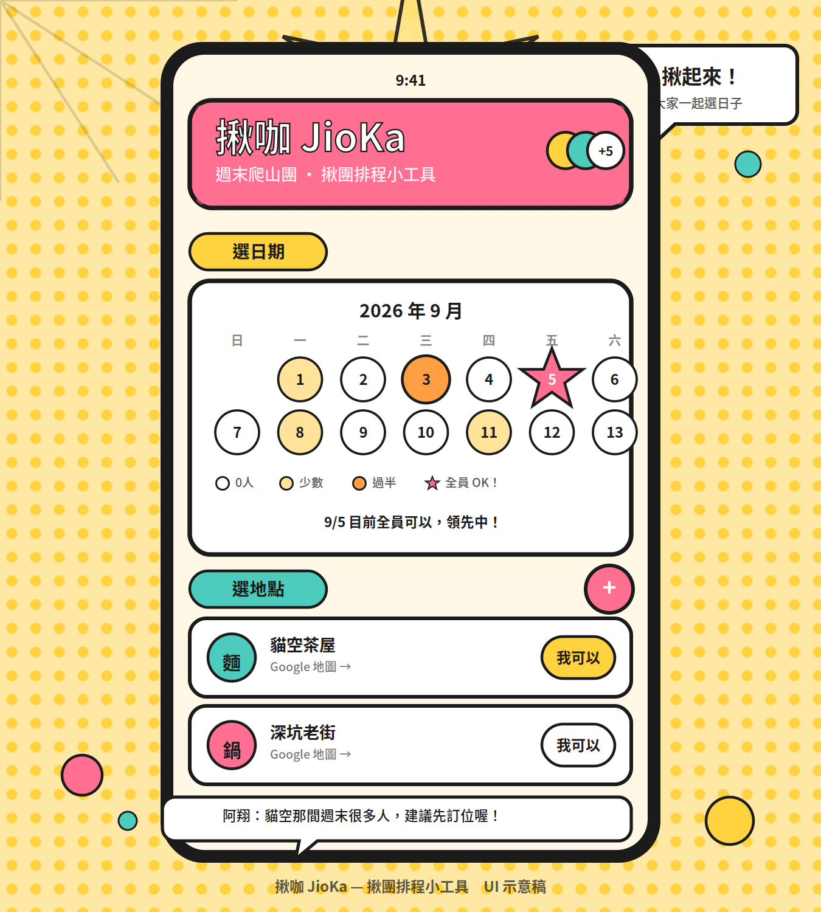

# 揪咖 JioKa 🎉

> 揪團排程小工具：一群人用**月曆勾選**方便的日期時段、**票選地點**、留言提建議，即時統計哪個方案最熱門。
> 不自建伺服器與資料庫 —— 後端用 Google Apps Script、儲存用 Google 試算表，全部落在 Google 免費額度內。



> 📘 這份 README 的部署教學 + 使用手冊，也有一份可跟著操作、含目錄導覽的網頁版：[`docs/guide.html`](docs/guide.html)（部署到 GitHub Pages 後即可透過 `.../guide.html` 開啟）。

## ✨ 功能特色

- 🗓️ **月曆投票**：候選日期直接畫在月曆上，點日期選時段；票數用色階呈現（白→淺黃→橘），全員 OK 的日期會蓋上星芒爆炸圖 ★
- 📍 **地點票選**：候選地點含 Google Map 連結，「我可以」一鍵表態
- 💬 **留言建議**：漫畫對話框造型，可針對特定選項留言（例如「這間假日很多人，建議訂位」）
- ⚡ **即時統計**：10 秒輪詢 + 版本號輕量更新，別人投票你立刻看到
- 👑 **主揪自動認定**：第一個建立活動的人就是主管理者，可用 Email 指定次管理者幫忙擴充選項
- 🔁 **再揪一次**：一鍵複製上次的活動類型與地點清單，3 秒開新場
- 📒 **我的揪咖紀錄**：發起過、參加過的活動都留著，每一場開心的投票都是回憶
- 🎊 **結果卡**：標記最終方案後產生紀念卡，適合截圖分享
- 📊 **管理後台**：參與者明細、留言管理、延長/提前結束投票、CSV 匯出
- 🔒 **安全**：Google 帳號登入（僅取 Email/顯示名稱）、後端驗證 ID token、試算表不對外公開

## 🏗️ 系統架構

```
[前端：靜態網頁 Vanilla JS（docs/），部署於 GitHub Pages]
        │  fetch (JSON over POST)
        ▼
[後端：Google Apps Script Web App（gas/Code.gs）]
        │  SpreadsheetApp API
        ▼
[資料層：Google 試算表 × 5 張工作表]
```

- 前端無框架、無建置步驟，改完推上 GitHub 即生效
- 後端以 `LockService` 防止併發覆寫、`CacheService` 快取 token 驗證與版本號，保護每日執行配額
- 所有寫入操作都經過後端權限檢查，前端不持有試算表任何權限

## 📁 專案結構

```
jioka/
├── README.md            ← 本文件（部署 + 使用手冊）
├── clinepass-prd.md     ← 產品需求文件
├── jioka-ui-mockup.png  ← UI 視覺示意稿
├── gas/
│   ├── Code.gs          ← Apps Script 後端完整程式（貼上即用）
│   └── appsscript.json  ← Apps Script 設定（時區、權限範圍）
└── docs/                ← 前端（GitHub Pages 目錄）
    ├── index.html
    ├── style.css        ← 漫畫風樣式
    ├── app.js           ← SPA 主程式
    └── config.js        ← 【部署時要改】API 網址與 Client ID
```

---

# 🚀 部署教學（約 15 分鐘）

> 只需要一個 Google 帳號 + 一個 GitHub 帳號，全部免費。

## 步驟 A：申請 Google OAuth Client ID（約 5 分鐘）

1. 前往 [Google Cloud Console](https://console.cloud.google.com/)，建立新專案（名稱隨意，例如 `jioka`）
2. 左側選單 →「API 和服務」→「**OAuth 同意畫面**」
   - 類型選「**External**」→ 建立
   - 填寫應用程式名稱（例如「揪咖 JioKa」）、使用者支援電子郵件（選自己的）、開發人員聯絡資訊（填自己的 Email）
   - 其餘頁面直接「儲存並繼續」到底（不需要加 scopes、不需要提交審核；測試階段只有自己與你加入的測試使用者能登入，若要让任何人登入請看下方 FAQ）
3. 「**憑證**」→「建立憑證」→「**OAuth 用戶端 ID**」
   - 應用程式類型：**網頁應用程式**
   - 名稱：隨意（例如 `jioka-web`）
   - 「**已授權的 JavaScript 來源**」加入：
     - `https://<你的帳號>.github.io`（GitHub Pages 網域，**不要加斜線結尾**）
     - `http://localhost:8000`（本機測試用，可選）
4. 建立後複製「**用戶端 ID**」，長得像 `123456789-xxxx.apps.googleusercontent.com`

## 步驟 B：建立 Apps Script 後端（約 5 分鐘）

1. 前往 [Google Apps Script](https://script.google.com/) →「新專案」
2. 把 `gas/Code.gs` 的內容**全部複製貼上**到編輯器（取代預設內容）
3. 把檔案開頭的 `GOOGLE_CLIENT_ID` 換成步驟 A 拿到的 Client ID：
   ```js
   const GOOGLE_CLIENT_ID = '123456789-xxxx.apps.googleusercontent.com';
   ```
4. （建議）左側「專案設定」⚙️ → 勾選「在編輯器中顯示 appsscript.json 資訊清單檔案」→ 編輯器會出現 `appsscript.json`，把本專案 `gas/appsscript.json` 的內容貼上覆蓋（設定台灣時區與最小權限範圍）
5. 在函式下拉選單選擇 `setup` → 點「**執行**」
   - 第一次執行會要求授權：選自己的帳號 →（可能出現「Google 尚未驗證這個應用程式」）點「進階」→「前往 ○○（不安全）」→「允許」
   - 這是**你自己的** Apps Script 呼叫**你自己的**試算表，放心授權
   - 執行成功後看「執行記錄」，會印出 `✅ 初始化完成！試算表網址：https://...`
   - **這個試算表就是你的資料庫**，建議打開網址加書籤（之後看原始資料、救誤刪活動都靠它）
6. 部署：右上角「**部署**」→「**新增部署作業**」
   - 類型：選「**網路應用程式**」（Web app）
   - 說明：隨意，例如 `v1`
   - 「執行身分」：**我（自己的帳號）**
   - 「誰可以存取」：**所有人（Anyone）** ← 注意不是「僅限自己」
   - 點「部署」，複製產生的 **網路應用程式網址**（結尾是 `/exec`）

## 步驟 C：設定前端（1 分鐘）

編輯 `docs/config.js`，填入兩個值：

```js
const JIOKA_CONFIG = {
  API_URL: 'https://script.google.com/macros/s/AKfycb.../exec',   // 步驟 B 的網址
  GOOGLE_CLIENT_ID: '123456789-xxxx.apps.googleusercontent.com',   // 步驟 A 的 Client ID
  POLL_INTERVAL: 10000,
};
```

## 步驟 D：部署到 GitHub Pages（約 3 分鐘）

1. 把本專案推到 GitHub（或直接用 GitHub Desktop 發佈）
2. 到 repo 頁面 →「**Settings**」→「**Pages**」
   - Source：「**Deploy from a branch**」
   - Branch：`main`，資料夾選「**/docs**」→ Save
3. 等 1–2 分鐘，開啟 `https://<你的帳號>.github.io/jioka/`（repo 名稱不是 jioka 的話路徑會不同）
4. 如果 GitHub Pages 網域跟步驟 A 設的不一樣（例如自訂網域），記得回 Cloud Console 把正確網域加進「已授權的 JavaScript 來源」

## ✅ 驗收測試清單

部署完照著走一遍，確認整條鏈路通：

1. 開啟前端網址 → 點「發起揪咖」→ 出現 Google 登入按鈕 → 登入成功
2. 建立活動：填名稱、選幾個日期+時段、加一個地點 → 送出 → 看到分享連結 Modal
3. 打開試算表：Events / Options / Participants 表各多了一筆資料
4. 用**無痕視窗**開活動連結，登入**另一個 Google 帳號** → 設暱稱 → 勾日期/地點 → 留言
5. 回原視窗：10 秒內統計自動更新（日期上色、地點顯示人名）
6. 進「管理後台」：看到明細表、可以刪留言、設截止時間、匯出 CSV
7. 「標記最終方案」→ 跳到結果頁 → 看到結果卡 🎊

如果卡關，先看下方 [常見問題](#-常見問題-faq)。

---

# 📖 使用手冊

## 我是主揪（發起人）

1. **發起活動**：首頁點「🎉 發起揪咖」→ 登入 Google → 填活動名稱、類型（影響預設時段）、說明、截止時間（可留空）
2. **選日期**：在月曆上點日期 → 勾選時段（可複選或自訂，例如「傍晚」）；選過的日期時段會列在下方，可點 ✕ 移除
3. **選地點**：填地點名稱 + Google Map 連結（可留空），可放多個
4. **建立並分享**：送出後把連結丟到 LINE 群組（Modal 有現成的 LINE 分享按鈕）
5. **管理後台**（投票頁的「🛠️ 管理後台」按鈕）：
   - 看每位參與者的暱稱、Email、勾選明細
   - 刪除不當留言、刪除選項（主揪可刪任何選項）
   - 延長/修改截止時間、立即提前結束投票
   - 用 Email 指定次管理者幫忙擴充候選範圍
   - 投票結束後「🎊 標記最終確定方案」→ 產生結果卡，結果頁永久可查
   - 下載 CSV 明細
6. **再揪一次**：任何活動頁點「🔁 再揪一次」，自動複製類型與地點清單，重選日期就開新場

## 我是參與者

1. 打開朋友給的連結 → 用 Google 登入 → 設定本場暱稱（同場不能撞名）
2. **選日期**：點月曆上的候選日期 → 勾你 OK 的時段（再點一次取消）；點還不是候選的日期可以**提議新日期**
3. **選地點**：點「我可以」（可複選）；也可以「＋ 新增候選地點」
4. **留言**：下拉選「對整場活動」或特定選項，輸入建議送出
5. 截止前隨時回來改都可以；截止後投票與留言鎖定，結果頁仍然開放查看
6. 首頁「我的揪咖紀錄」可以回顧所有參加過的活動

## 我是次管理者

主揪在後台輸入你的 Gmail 後，你用該 Google 帳號登入即自動取得權限：可**新增**候選日期/地點、刪除留言、查看投票明細；不能修改主揪設定的選項與活動設定。

---

# 🗄️ 資料模型（試算表 5 張表）

| 工作表 | 內容 | 備註 |
|---|---|---|
| `Events` | 活動主檔（標題、類型、狀態、截止、最終方案、主/次管理者、建立/更新時間） | `status`：open / closed / confirmed / deleted（軟刪除）|
| `Options` | 候選選項（日期+時段 或 地點+Map 連結、建立者） | `is_deleted` 軟刪除 |
| `Votes` | 投票（event_id × option_id × user_email，覆蓋式更新） | 改票=刪舊列寫新列 |
| `Comments` | 留言（可指向特定選項） | 僅管理者可刪（軟刪除）|
| `Participants` | 參與者（每場活動的暱稱、加入/最後訪問時間） | 暱稱同場唯一 |

# 🔌 後端 API 一覽

統一 `POST { action, token?, ...參數 }`（`Content-Type: text/plain`），回應 `{ ok, data }` 或 `{ ok:false, error:{code,message} }`。

| action | 權限 | 說明 |
|---|---|---|
| `ping` | 公開 | 健康檢查 |
| `getEvent` | 公開（帶 token 附帶我的投票/角色）| 活動完整資料；帶 `since` 版本相同只回 `{changed:false}` |
| `createEvent` | 登入 | 建立活動，建立者自動成為主管理者與參與者 |
| `duplicateEvent` | 登入 | 再揪一次（複製類型/說明/地點）|
| `checkNickname` / `setNickname` | 登入 | 暱稱檢查/設定（同場唯一，改名同步歷史紀錄）|
| `submitVotes` | 參與者 | 覆蓋式送出我的全部勾選（截止後拒絕）|
| `addOption` | 參與者（截止後限管理者）| 新增日期/地點選項（重複自動略過）|
| `deleteOption` | 主管理者全部；次管理者限非主揪建立 | 軟刪除選項 |
| `addComment` | 參與者 | 留言（可指向選項；截止後關閉）|
| `deleteComment` | 主/次管理者 | 軟刪除留言 |
| `listMyEvents` | 登入 | 我發起的/我管理的/我參加的 |
| `getAdminDetail` | 主/次管理者 | 參與者投票明細（含 Email）|
| `updateEvent` / `setDeadline` / `closeEvent` | 主管理者 | 改設定 / 調截止（設未來時間自動重開）/ 立即截止 |
| `manageCoAdmins` | 主管理者 | 新增/移除次管理者 |
| `confirmResult` | 主管理者 | 標記最終方案（日期+地點），狀態轉 confirmed |
| `deleteEvent` | 主管理者 | 軟刪除整場活動 |
| `exportCsv` | 主/次管理者 | 產生 CSV 明細（含 BOM，Excel 直接開不亂碼）|

# ❓ 常見問題 FAQ

**Q：改了 `Code.gs` 之後前端沒有變？**
Apps Script 的 `/exec` 網址是「部署快照」：每次改程式都要到「部署 → 管理部署作業 → 編輯 → 版本選『**新版本**』→ 部署」才會生效。開發期間想快速測試，可以改用「測試部署」的 `/dev` 網址（永遠跑最新碼，但只有部署者本人能存取）。

**Q：登入按鈕沒出現 / 出現錯誤？**
檢查 Cloud Console 的「已授權的 JavaScript 來源」是否包含你**實際開啟**的網域（`https://xxx.github.io`，注意大小寫與有無尾斜線）。Client ID 前後端兩處要填同一組。

**Q：任何人都能用我的揪咖嗎？**
OAuth 同意畫面若是「測試」狀態，只有你加入的測試使用者能登入。要開放所有人：Cloud Console →「OAuth 同意畫面」→「**發佈應用程式**」（本工具只取 email/profile 基本範圍，通常無需人工審核即可發佈）。

**Q：token 過期怎麼辦？**
Google ID token 效期 1 小時，過期後操作會提示重新登入，再點一次登入按鈕即可，投票資料不會遺失。

**Q：資料會不會遺失？誰看得到？**
所有資料存在**你（部署者）帳號下的試算表**，前端看不到也碰不到試算表，只能透過 Apps Script API 存取。刪除活動/選項/留言都是軟刪除（標記不顯示），要復原可直接改試算表。

**Q：規模上限？**
設計目標為單場 50–100 人投票。試算表可存數萬場活動；若單場人數或活動數暴增，再考慮把 Repository 層（`readTable`/`appendRow` 等函式）換接 Firebase，API 契約不用動。

**Q：想用指令管理 Apps Script？**
可安裝 [clasp](https://github.com/google/clasp)：`npm i -g clasp` → `clasp login` → 在 `gas/` 目錄 `clasp create` 或 `clasp clone` → `clasp push` 推送程式，方便版控。

# 🔐 隱私與安全說明

- 登入採 Google Identity Services，**只取 Email 與顯示名稱**，不索取其他權限、不存密碼
- 前端拿到的 ID token 只在記憶體與本機 localStorage（效期 1 小時）
- 後端驗證 token 時會比對 `aud` 是否為本專案的 Client ID，防止他站 token 混用
- 公開 API（`getEvent`）不回傳任何參與者 Email；Email 明細僅主/次管理者可見

---

揪得開心！🎉 有 bug 或建議歡迎開 Issue。

